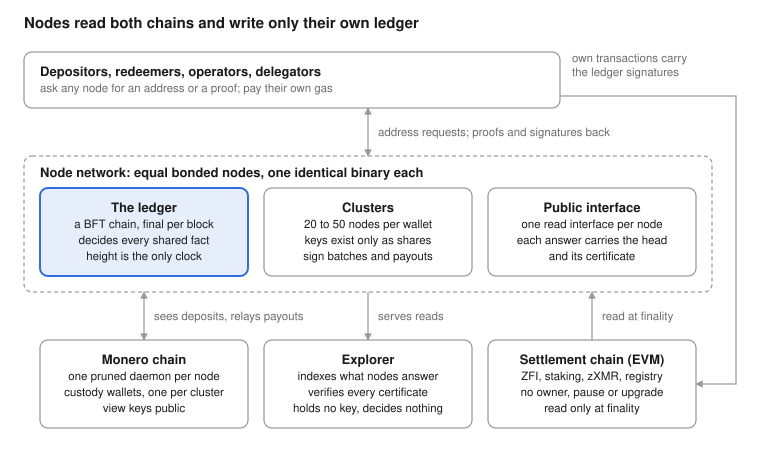
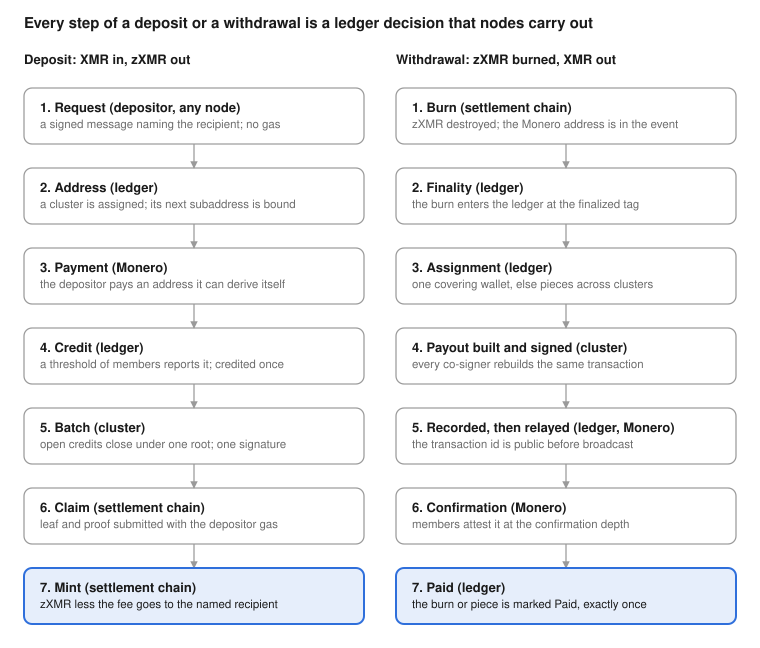

# ZeroFi: Threshold Custody of Monero under an Open, Bonded and Rotating Set of Nodes

Version 1.0, October 2026. The ZeroFi team.

## Abstract

The ZeroFi network is a set of equal bonded nodes that holds Monero in threshold custody and issues zXMR, a wrapped asset minted only against deposits of XMR, on an EVM settlement chain. Four contracts on the settlement chain carry the tokens, the bonds and the record of custody; none has an owner, a pause or an upgrade path. Every shared fact is decided on one Byzantine fault tolerant ledger kept by the nodes themselves; nodes hold key material and carry out what the ledger schedules, and no node decides anything.

The network has no custodian and no administrative key: XMR is held by clusters of 20 to 50 nodes, and no machine ever holds a cluster's key. A deposit address stays valid through every change of membership, because a change of roster passes the same keys to the new members instead of moving the funds. A withdrawal is paid exactly once by construction rather than by bookkeeping, and the failure of any one node at any step of a payment loses nothing.

Every operator posts the same fixed bond. Income comes from a flat fee on each mint and each burn and, while the reward pool lasts, from a scheduled emission of the staking token; delegation of that token buys a share of the fee income and nothing else. The design was tested in a deterministic simulator that runs the production code of whole networks under scheduled faults, by an exhaustive search for stalls, by drills on real networks with unannounced kills, and by a public testnet holding real Monero.

To the ZeroFi team's knowledge, ZeroFi is the first publicly joinable network that holds Monero in threshold custody under an open, bonded and rotating set of operators, keeps every deposit address valid through membership changes, and issues a wrapped asset on an EVM chain with no custodian, no administrative key, no relayer and no gas paid by nodes; its public testnet, launched on 11 October 2026, has held real Monero under these rules since the following day.

## 1. Introduction

The ways of representing Monero on another chain that the ZeroFi team knows of all rest on a party that must be trusted, and the ZeroFi network replaces that party with bonded nodes that follow rules anyone can check. Monero (van Saberhagen, 2013; Noether, Mackenzie and the Monero Research Lab, 2016) hides the amount and the recipient of every payment and has no scripting, so neither a light client nor a locked coin is available to a contract on another chain. Representing XMR on another chain has therefore meant trusting a custodian, a fixed federation of signers or a counterparty for each trade (Section 11).

A bridge for Monero without a trusted party must hold custody by rule, with reserves anyone can audit despite Monero's privacy; change its signers as operators come and go, without pausing deposits or moving the funds; mint only against a deposit the custody has received, never by an administrative act; and stay live with nobody on call, since a bridge that needs a person to recover has a hidden custodian.

### 1.1 Terms

A node is one running instance of the node software, released as znode. An operator runs a node and has posted its bond, a fixed amount of ZFI, the network's staking and reward token, locked in the staking contract (Section 6). The nodes keep the ledger, the network's own Byzantine fault tolerant chain, on which every shared fact is decided. Custody is all XMR held by the network. It is held by clusters: a cluster is a set of bonded nodes that jointly holds one Monero wallet and one authority key, the settlement-chain signing key whose single signature the contracts accept as the cluster's word (Section 4). A roster is the ordered member list of a cluster, or of the committee of bonded nodes that certifies the ledger (Section 4). The settlement chain is the EVM chain that carries the four contracts; on the public testnet it is Ethereum's Sepolia test network, called Sepolia below. Among the contracts is the zXMR token, the wrapped asset, one unit of which represents one piconero. A depositor sends XMR to a deposit address and receives zXMR. A redeemer burns zXMR naming a Monero address and receives XMR. A delegator holds ZFI and delegates it to a node for a share of that node's fee income.

### 1.2 The design

The design answers the four requirements with one principle: the ledger decides, and nodes execute. A committee drawn from the bonded nodes certifies the ledger block by block. Clusters of 20 to 50 nodes sign under a 2f+1 threshold (Section 4), so f faulty members can neither sign alone nor stop the rest. One key ceremony per cluster, run on the ledger, yields both the cluster's Monero spend key and its authority key, and a change of roster passes the same keys to the new members, so the deposit address never changes. Deposits are credited by the cluster's own members, batched under one signature and claimed by depositors at their own expense; burns become payouts that the ledger schedules and the cluster signs, paid exactly once.

The public testnet runs this design on real Monero, with its genesis naming Monero mainnet and only the token side on Sepolia. Operators from outside the project joined with one command and were taken into the custody cluster by key rotation on the ledger. Deposits of real XMR were credited and claimed, and withdrawals were paid; Section 9 gives the dated measurements.

### 1.3 Scope and plan of the paper

This paper gives in full every rule verifiable from outside the network, from the contracts and the flows as a depositor or redeemer sees them to the parameters pinned in the public genesis file and the measured record. The internals of the custody protocol are described by their guarantees and their consequences for a depositor, redeemer, operator or delegator rather than by their construction. A previous generation of the software decided much locally; the present one decides nothing outside the ledger.

Sections 2 and 3 give the goals, the constraints and the parts; Sections 4 to 7 the node network, custody, the settlement layer and the economic model; Sections 8 to 10 the security model, the reliability design with the measured record, and what anyone can verify; Sections 11 and 12 the comparison with prior approaches and the path to mainnet. A glossary with the references closes the paper.

## 2. Design goals and constraints

Each design goal below is a property an outsider can check, and each constraint is a fact of the two chains or of commodity hosting that fixed how far a goal could be pushed.

### 2.1 Goals

The network has no custodian and no administrative key. No key can move custody, mint zXMR or pause a contract: the four contracts have no owner, no pause and no upgrade path, no machine ever holds a cluster's key, and a bond (Section 1) buys income only (Section 7). The residual is a colluding signing threshold of one cluster, which could sign an unbacked batch or spend that cluster's custody (Section 8 gives the deterrents).

One ledger owns every shared fact. Nodes hold key shares and their own record of a wallet and carry out what the ledger schedules; nothing a node says about itself is a verdict, only an input the rules weigh, and unavailability is never a verdict either. Height is the only clock in a decision (Section 4). We chose blocks rather than seconds as the clock because a height is a committed fact every node reads alike, whereas a clock reading is one machine's assertion. Finality has three meanings, one per chain: a ledger block is final once certified; a settlement-chain fact counts only at that chain's finalized tag; a Monero deposit counts only at a fixed confirmation depth (Section 5).

The network stays live without an operator. A person is needed in two cases: a binary upgrade when Monero or the settlement chain changes its rules, and the crypto floor, the state of a cluster with fewer live share holders than its signing threshold, whose funds wait until members return. The crypto floor is the only accepted stall of custody; a committee that loses more than a third of its seats pauses the ledger rather than forking it and resumes when the seats return. Every other stall is a defect, and the measure of the design is how long the live network runs with nobody touching it (Section 9).

Every node is equal and runs on commodity hardware. One binary, identical on every node, is installed by one command; there are no special nodes, no enclaves and no hardware security modules (Section 4); and nodes pay no gas (Section 6). Seats and cluster membership are drawn by a public rank among equal fixed bonds, so no amount of stake steers custody (Section 7 gives the reason).

The network has the single-vault property: depositors and redeemers never see or choose a cluster, and withdrawals draw on all custody. Capacity grows by adding clusters, which divide, merge and renew by rule (Section 5).

Every rule and record this paper states can be checked from outside the network. Every answer a node gives about the ledger carries the newest committed block with its certificate (Section 4), every custody wallet is auditable from its public view key (Section 5), and the contracts are plain and immutable.

### 2.2 Constraints

Each constraint below rules out a shortcut that other bridges take.

- Monero's transaction format and privacy, with no scripting, mean that custody must be an ordinary Monero wallet whose every spend the signers build and check themselves.
- Gas on the settlement chain is paid per signature verified, so a batch of deposits must be authorised by one signature whatever the size of the cluster.
- The bonded set changes from day to day, so keys must pass to a changed roster without moving the funds or pausing deposits.
- Consumer virtual private servers have ordinary links and disks, so state, traffic and disk must stay bounded.
- A node or the whole network must resume after any restart or outage from durable state alone.

## 3. System overview

Every shared fact in the ZeroFi network is decided on one ledger; the parts around it (equal nodes, clusters of nodes holding the Monero, four contracts on the settlement chain, a public interface on every node and an explorer) hold keys, balances or copies, never decisions.



Figure 1 shows the parts and what passes between them: nodes read Monero and the settlement chain and write only the ledger, while depositors, redeemers and operators carry the ledger's signatures to the settlement chain in their own transactions.

### 3.1 The parts

Every node runs one identical binary as one process beside its own pruned Monero daemon, with no special node, gateway or helper process. The ledger is the network's own chain; a committee drawn from the bonded nodes certifies each block (Section 4), so a certified block is final.

A cluster (Section 1) holds its Monero wallet and its authority key through shares. Neither key exists on any machine: each member holds a share, a part of each key, and only a threshold of members together can sign. A key ceremony is the ledger-scheduled procedure in which a cluster's members generate or re-deal shares; a rotation is a key ceremony that passes the same keys to a changed roster, leaving the deposit address and the authority key unchanged.

Four contracts on the settlement chain carry the money and the membership: the ZFI token, the staking contract, the zXMR token, which is also the bridge contract, and the custody registry; none has an owner, a pause or an upgrade path (Section 6). Every node serves the same public interface, and every answer about the ledger carries the head, the newest committed block, with its certificate (Section 10). An observer is a node run without a bond; it follows and serves the ledger and signs nothing. The explorer, the public site that indexes and shows the ledger, consumes nodes' answers and decides nothing.

### 3.2 The relations

Nodes read two chains and write one. A node reads the settlement chain only at that chain's finalized tag, reads Monero only through its own daemon, and writes nothing but the ledger; no message passes between the two chains. The settlement chain learns a ledger fact only from a signature carried inside a depositor's, a redeemer's or any other actor's own settlement-chain transaction: a cluster's signature over a batch, or a committee's over a lineage step. A lineage is the sequence of committee rosters the custody registry has accepted; a lineage step is one signed record advancing it, prepared by the ledger like each cluster certificate and carried by the first claimant whose claim needs it. A node never pays gas: depositors pay for their claims, redeemers for their burns, operators to stake and to leave, and slashers for their evidence (Section 6).

### 3.3 The three flows

Deposit, withdrawal and rotation are the only flows (Section 5), each a chain of ledger decisions that nodes carry out. A deposit runs request, address, payment, credit, batch, claim and mint: the depositor asks any bonded node for an address and pays it; the members report the payment and the ledger credits it at most once; credits close into a batch under one Merkle root that the cluster signs once; and the depositor claims the mint on the settlement chain in its own transaction. A withdrawal, the redeemer's whole flow from burn to XMR received, runs burn, finality, assignment, payout and confirmation: the ledger reads a burn at the settlement chain's finality and assigns it to a wallet that covers it or to pieces across several; that wallet's cluster signs one payout, a Monero transaction paying one or more burns, records it on the ledger and relays it; and members confirm it at depth. A rotation begins when a node joins a cluster, leaves it or is struck, and hands the same keys to the new roster (Section 5).

### 3.4 What lives where

Keys and wallet records live on nodes, decisions on the ledger, balances and authorisations on the settlement chain. A node holds its node key and shares, encrypted at rest, and its own record of each wallet it serves; it holds no decision, the rest of its memory is disposable, and a node that stops at any moment resumes from the ledger alone. The ledger holds who is bonded and present, who sits in the committee, which cluster holds which wallet, which deposit is credited and which payout pays which burn; the settlement chain holds every balance, bond, delegation and authorised batch root and the registry's record of clusters and committees. Each layer is ignorant of the other layers' formats, and no layer re-derives a fact that another layer owns. Every custody step is a signed ledger transaction; only bonded nodes may sign one, and signing costs them nothing.

## 4. The node network: membership, the ledger, clusters and upgrades

Membership is a bond and nothing else: a node is admitted by its stake, takes its duties by the ledger's rules, and leaves by withdrawing it.

### 4.1 Membership is the bond

One secp256k1 key, the node key, is a node's identity on the ledger and on the network, holds its bond and signs its ledger messages; to stake is to lock the bond in the staking contract (Section 6). Links are encrypted and authenticated by the same key; a peer is a node seen across such a link. Only a bonded key becomes a full peer, so stake, not an operator list, admits a node; an observer (Section 3) gets at most a few read-only links.

An operator joins with one command and two answers: a settlement-chain endpoint and a funded key that becomes the node key. The node software, znode, carries the network's facts; the command installs the node, a pinned pruned Monero daemon (whose sync from scratch takes days) and supervision, stakes once and starts the node. We made the join idempotent, so the same command upgrades or repairs a node. The backup is two files written once at setup, restored by putting them back and re-running the join; a node that has left a chain never rejoins it under the same key, and a running node never empties its store. An operator's own settlement-chain sends (Section 6) replace a stuck send at its own nonce and, where two or more endpoints are configured, take no number from one endpoint alone.

| Part | Requirement |
|---|---|
| CPU | 4 vCPU |
| Memory | 8 GB |
| Disk | 250 GB SSD or NVMe |
| Network | own public IPv4, 1 Gbit port, 2 TB a month or unmetered |
| System | Ubuntu 22.04 or 24.04 or Debian 12, x86-64 |

### 4.2 The ledger

A committee of bonded nodes certifies each block, and a certified block is final: it is never reverted, no two blocks are committed at one height, every node recomputes the state root in its header, and the ledger stays safe with fewer than one third of the committee faulty. Agreement follows a classical partially synchronous Byzantine fault tolerant protocol with two-thirds certificates and immediate finality; every member proposes in turn. A height begins one block time after its parent's timestamp, and a block's timestamp must exceed its parent's by at most a bound that lets a long outage resume (Section 9).

Every input a node accepts and every vote it casts goes to a write-ahead log before the node acts on it or sends it; a restarted node replays, re-sends and never signs two conflicting votes. The rules are pure functions of committed state and block, height their only clock; the build rejects any decision rule that reads the wall clock, the environment or ambient randomness. The genesis file's bytes define a network: their hash is the chain id, every value is checked at load, and networks with different parameters cannot merge.

Settlement-chain facts enter the ledger only at that chain's finality, each voter verifying them against its own reading, so an outage there delays them and never halts the ledger. A node reads through several endpoints in turn and believes a view only when a second independent endpoint rebuilds it alike; configuring a single endpoint is the operator's choice.

### 4.3 The committee

The committee is a pure function of committed state. A seat is one committee membership; the committee is recomputed at the end of every epoch, a fixed span of ledger blocks; a certificate is at least 2f+1 of the 3f+1 members' signatures over one block. Seats go to bonded, present nodes by a deterministic public rank under an epoch seed; the size grows with participation, seats rotate gradually, none is permanent, and stake weight (Section 7) never counts. A presence is a node's periodic signed heartbeat on the ledger, carrying its version, network address and wallet readiness; a silent node loses eligibility within minutes and regains it on return. A node loses its seat only through scheduled rotation, an expired presence, a lost bond or equivocation, one node signing two conflicting consensus messages at one height, which is detected automatically, recorded on the ledger and unseats the equivocator at the epoch end (Section 6).

| Parameter | Value |
|---|---|
| Block time | 12 seconds, a nominal lower bound |
| Epoch | 250 blocks, about 50 minutes |
| Committee size | 10 to 157 seats |
| Fault bound | f = floor((n - 1) / 3), n = 3f + 1; a certificate needs 2f + 1 |
| Blocks a node keeps | 4 epochs, about 1,000 blocks |

### 4.4 Clusters

A cluster's members hold its keys through shares: a member is a node in a cluster, and a share holder a member with working shares of the current keys. A cluster has 20 to 50 members and signs with 2f+1 of them under the table's fault bound: 13 of 20, 33 of 50. Below the merge floor of 16 members a cluster hands its custody to another (Section 5). Every bonded node sits in at most one primary cluster, and many clusters may exist at once. A cluster forms when enough unassigned bonded nodes exist; every seat is decided by a deterministic public rank, no node chooses its cluster, and no stake weight influences it. A strike is the ledger's record of a missed key ceremony; two consecutive strikes drop the member from the next roster, with no bond lost and the ordinary path open to rejoin, and a counted contribution clears them.

### 4.5 Gossip, catch-up and bounded state

Gossip is signed by its author and checked before forwarding, so invalid data stops at the first honest node. The ledger is the peer directory: nodes find each other through presence records and redial every block. A new or returning node catches up from any peer by blocks or a verified snapshot, each block checked against its certificate and state root. Each node keeps one embedded database, every commit forced to disk, holds the table's window of blocks and a fixed number of snapshots, and prunes the rest. Pending work is bounded in count and bytes and expires by height. Every record carries its own retirement rule; a census, a count of every record kind in the store, runs at every epoch end, and loss records and one fee counter (Section 7) are kept for the ledger's life.

### 4.6 Upgrades

Upgrades activate through a version floor, the lowest protocol version the ledger accepts at a height, with no coordinator, flag day or vote; presences and headers carry versions. An upgrade activates at a height once every set whose signatures the network needs carries the new binary at its own threshold; until then the old version runs, at that height an outdated binary stops instead of forking, and the floor never falls. A re-genesis, a new chain from a new genesis, is for test networks only (Section 12).

## 5. Custody: deposits, withdrawals and key rotation

Custody moves only by rule. Wallet keys exist only as shares across one cluster, every step that touches a wallet is a signed ledger transaction, and one credit per output and one payment per burn hold by construction.



Figure 2 gives both flows at a glance; Sections 5.2 and 5.4 state each step's rule. A deposit is credited once and claimed by the depositor; a withdrawal is paid once by a payout whose transaction id is public before it is relayed.

### 5.1 Custody by shares

A wallet, the Monero wallet a cluster holds with the outputs the ledger books to it, has keys no machine ever holds. Its Monero spend key and its authority key (Section 1) are generated jointly on the ledger in one publicly verifiable key ceremony (Section 3); a ceremony that misses its deadline is retried from scratch. The sharing follows Shamir (1979) and the signing the FROST family of threshold Schnorr signatures (Komlo and Goldberg, 2020; Schnorr, 1991); their adaptation to Monero's CLSAG ring signatures (Goodell, Noether and RandomRun, 2019) is not described in this paper.

The wallets are transparent by design: the view key, which reveals incoming payments, is public, so anyone sees every payment into custody. A key image is Monero's spend marker (van Saberhagen, 2013); the ledger publishes the key image of every custody output, so every spend of a custody wallet, including one outside the protocol, is visible to anyone reading the ledger.

### 5.2 The depositor's flow

A deposit is credited at most once, at the amount that arrived, to the recipient the depositor named.

1. The depositor signs a deposit request, an EIP-712 typed message (Bloemen, Logvinov and Evans, 2017) naming the recipient's settlement-chain address, and posts it to any bonded node, paying no gas and naming no cluster.
2. The node carries the request onto the ledger, which assigns a cluster, spreading deposits across clusters, and binds that cluster's next unused subaddress, a Monero address derived from the wallet's keys and an index, to it as the deposit address.
3. Once the row is committed the node returns the address, its subaddress index and the cluster's public view key; with these and the cluster's public spend key from its cluster certificate (Section 6), the depositor derives the same subaddress itself and watches the payment arrive.
4. The depositor pays; the payment is the deposit.
5. Each member scans its own Monero daemon and reports an output to the ledger at the confirmation depth. A credit, the ledger's record that the output is accepted, is written when a threshold of current members has reported the same output, at most once per output, ever.
6. At the batch cadence a cluster's open credits close into a batch (Section 3), which the cluster signs once with its authority key.
7. The depositor fetches the proof and the signature from any node and claims on the settlement chain with its own gas; the claim mints zXMR for the amount less the bridge fee (Section 7) to the recipient the depositor named, whoever submits it.

A late payment inside the address validity is credited, and a wrong amount is credited as it arrived; after the validity, beyond a short grace window, nothing is credited. Dust below the minimum, the one floor for a credit, a burn and a payout remainder, is not a deposit; an output locked by time is never credited, and one locked to a block height is credited once the lock has passed, if still inside the validity. An unpaid request expires, a re-sent request returns the same address, and unpaid requests per recipient and cluster are capped, so a node that floods blocks only its own. For a depositor these add up to about twenty minutes from the payment's mining to its credit and at most one batch cadence more to a claimable batch.

### 5.3 Reorganisations

A Monero reorganisation deeper than the confirmation depth can remove a credited output. Each member keeps its own record of the wallet from its own daemon, rewound or rescanned after a reorganisation. When a threshold of members reports a credited output gone, the ledger reverses the credit: unclaimed, its id is revoked on the settlement chain under the same authority signature, carried in the next batch's authorisation by that batch's first claimant, and never mints; claimed, it becomes a reserved loss, a permanent public record.

### 5.4 The redeemer's flow

A burn of zXMR is paid in XMR exactly once from all custody; no delivery time is promised.

1. The redeemer burns zXMR on the settlement chain naming a Monero address (Section 6).
2. The burn enters the ledger at the settlement chain's finalized tag, keyed by its block and log index, under which its payout entries and their transaction ids are served.
3. Only Monero mainnet addresses (standard, subaddress or integrated) are payable; a burn to any other is Unpayable, the burner's loss. A burn below the minimum after the fee writes nothing; its settlement-chain receipt is the record.
4. The ledger assigns the burn to one wallet when one covers it, otherwise in pieces across several clusters, each piece at least the minimum; a remainder below the minimum is not paid and is shown as such; a large burn may wait for balance.
5. The cluster builds the payout, one Monero transaction bounded in inputs and payments that spends deposits directly and returns change to the cluster's own address, and a threshold of members signs it.
6. The signed payout is a ledger row before it is broadcast, so its transaction id is public before any relay, and any member relays it.
7. Members that see it at the confirmation depth attest it on the ledger, which records the paying transaction id and marks the burn or piece Paid. Each payment bears a share of the network fee, Monero's transaction fee, in proportion to its amount.

### 5.5 Exactly once

A burn is bound to at most one live payout. A payout that does not reach the chain is replaced, and at most one version of it can ever be mined, so the burn is paid once whatever happens to the node that built the first attempt.

### 5.6 Rotation

A join, a leave, a strike or a fixed quiet interval triggers a rotation (Section 3), which passes the same keys to the changed roster. Deposits never pause and the settlement chain sees no change; withdrawals pause briefly while the new roster takes over. We chose to keep the address across membership changes rather than move the funds to a fresh key: a move costs a Monero transaction per rotation and invalidates every issued deposit address while a depositor may be paying it.

### 5.7 The cluster life cycle

Behind the single-vault property (Section 2), clusters divide, merge and renew by rule. In a division a full cluster splits in two: the parent keeps its keys, address and balance, the new cluster starts with fresh keys and an empty wallet, and no coins move. In a merger a cluster thinning below its floor hands its custody to a healthy cluster while it can still sign; its address, registry slot (Section 6), certificate and every issued deposit address stay valid, nothing changes on the settlement chain, and its wallet is later emptied into the receiving wallet and retired. In a renewal a cluster retires its wallet for a fresh key at the end of the wallet lifetime, so no key guards funds longer than that plus the time to empty the closed wallet, and nothing closes before its replacement exists. A closed wallet issues no address and takes no burn, credits payments to addresses issued before its close until they expire, is emptied by its holders into its successor by the same signed path as a payout, and leaves the state only at zero balance with nothing owed.

### 5.8 Flow parameters

| Parameter | Value | Scope |
|---|---|---|
| Credit confirmation depth | 10 Monero blocks | testnet and mainnet design |
| Deposit minimum | 0.01 XMR | testnet (mainnet not yet fixed) |
| Address validity | 24 hours (7,200 ledger blocks) | testnet and mainnet design |
| Unpaid requests per recipient and cluster | 8 | testnet |
| Batch cadence | 25 ledger blocks (about 5 minutes) | testnet |
| Payout limits | at most 8 inputs and 15 payments | constant |
| Wallet lifetime | 30 days (216,000 ledger blocks) | testnet and mainnet design |
| Settlement finality | the finalized tag, about 13 minutes on Sepolia | testnet |

## 6. The settlement layer: four contracts, bonds, slashing and the token

The settlement layer is four contracts with no owner, no pause and no upgrade path, and every rule below is checkable on the chain. ZFI is the bond asset; the staking contract holds bonds and pays income; the zXMR token, which is also the bridge contract, mints against batches of deposits and burns toward Monero addresses; the custody registry binds each cluster's authority key and follows the ledger's committee. No node writes to them; every fact they learn arrives inside a transaction that someone chose to pay for.

### 6.1 The four contracts and their links

The deployer's only power is to link the contracts once, through two one-time calls open to the deployer alone, each accepted only for a contract that points back at the caller; the other references are fixed at construction. That check catches a mistaken deployment, not a malicious deployer, and the links are public for anyone to check. No function mints ZFI after construction, halts transfers, changes a parameter or replaces code; both tokens follow EIP-20 (Vogelsteller and Buterin, 2015).

### 6.2 The staking contract: bond, exit and release

An operator bonds exactly one fixed amount per address. A stake moves the bond (table below) into the contract and lists the address at once; an exit request unlists it at once and ends its income. A release returns the bond once the lock (table below), counted in settlement-chain blocks from the stake, and the drain, counted from the exit request, have passed and the registry no longer needs the address. The drain is sized so that a committee seated in the ledger's current epoch finishes that epoch before any member can leave; the public testnet's contract derives it from the ledger's timing, and the mainnet value is fixed at the deployment (Section 12). A released address may stake again with the same key; a slashed address never can.

The registry gates a release by the lineage (Section 3). A member of the roster the registry currently trusts cannot release, and once a lineage step has moved the registry off that roster, a further lag, counted in settlement-chain blocks, must pass, so every roster that a node's finalized reading could still take for current keeps its bonds at risk.

### 6.3 Slashing

The one slashable act is two conflicting consensus signatures by one node key at one ledger height, and anyone may prove it. From the two signed messages the staking contract recovers one signer, checks the conflict and that the bond is held, and takes the whole bond, split as the table states. The address is unlisted and blacklisted permanently; its own unpaid fee share returns to the split and its unpaid emission to the pool, and its delegators lose nothing. An exiting node stays slashable until its release, nothing else is slashable, and strikes (Section 4) carry no settlement-chain penalty. The contract judges the ledger's consensus messages directly, since they are EIP-712 typed data under its own domain; any node serves ready-to-submit evidence against a recorded equivocator.

### 6.4 Signatures the contracts verify

A node signature is ECDSA over secp256k1 on EIP-712 typed data whose domain names the chain id and the verifying contract; only one encoding is valid and any other recovers to nobody, so no signed message can be replayed on another chain, at another contract or for another purpose. A cluster's authority signature is a Schnorr signature (Schnorr, 1991) over secp256k1 of fixed size (table below), made of the 20-byte address of the nonce point and a 32-byte scalar; the verifier recomputes the challenge and checks it with one call to the chain's native ecrecover routine, so one signature authorises a whole batch and the gas does not grow with the cluster's size (Section 5). With the authority key given by its x coordinate p_x, A the curve point with that x coordinate and even y, m the message, G the generator and n the group order, a signature (r, s) is valid when s lies below n, r, s and e are all non-zero, and

```latex
e = \mathrm{keccak256}(r \,\|\, p_x \,\|\, \mathrm{keccak256}(m)) \bmod n, \qquad r = \mathrm{address}(sG - eA),
```

where the ecrecover call computes the right-hand side of the second equation.

### 6.5 The zXMR token: mint, revoke and burn

zXMR is minted in exactly one way: against a deposit that is a leaf of a batch root signed by the authority key of the slot that holds it, a slot being a cluster's permanent registry entry. To authorise a root, a submitter presents the slot, the root, the leaves, the authority signature and any registry update the batch still needs; the contract applies the updates, checks each leaf's fee, folds the leaves to the root, verifies the signature under the bound slot and publishes the leaves. A leaf is the hash of the deposit identity, the recipient, the amount and the fee, the fee being the amount times the bridge rate (Section 7), rounded down; the tree sorts its leaves, hashes each pair smaller first, carries an unpaired node up unchanged and refuses a duplicate leaf. A claim presents one leaf and a Merkle proof under an authorised root; the contract requires the leaf's deposit identity unused, marks it used, and mints the amount less the fee to the recipient named in the leaf, whoever submitted, and the fee to the staking contract.

A deposit identity is a hash of the Monero transaction id and output index, so a claim can be found from a transaction id. A deposit reversed before its claim is revoked under the same authority, which marks its identity used so it never mints. A burn is one call naming an amount and a Monero address: the fee moves to the staking contract at source, the rest is destroyed and the destination is recorded in the event in clear; the ledger, not the contract, parses the address.

### 6.6 The custody registry

The registry holds the tip of the lineage, which is the current committee roster with the ledger epoch that set it, and one slot binding per cluster. A slot is bound once by a cluster certificate, signed by the tip's roster at the quorum bar, naming the slot, the authority key, the cluster's public Monero keys and the roots of its member list and signing committee; a repeat is a no-op and a conflict reverts. A lineage step is signed by the outgoing roster over the current tip, the next roster's root and both epochs, read from the registry's own state, so a signature for any other state credits nobody and no old step replays. A step lands only on a roster every member of which holds a bond. The quorum bar is the two-thirds quorum of the signing roster's members whose bonds are still held, never below f + 1 of the whole roster with f the fault bound of the node network, so slashed members neither stall the lineage nor let f faulty members move it. A fact already current is a no-op, never a revert, so two claimants carrying the same update do not fail each other.

### 6.7 Who pays

A running node never sends a settlement-chain transaction, and there is no relayer, keeper or treasury. An operator pays gas only to approve and stake at joining and to exit and release at leaving. A depositor pays for its claim, and the first claimant of a batch also pays for its authorisation and any registry update it carries. A redeemer pays for its burn; a slasher pays for its submission and keeps the submitter's share.

### 6.8 Settlement parameters

| Parameter | Value | Scope |
|---|---|---|
| Bond | 1,000,000 ZFI | testnet; mainnet design |
| Bond lock | 365 days (2,628,000 settlement-chain blocks); 5 blocks on the public testnet | mainnet design; testnet |
| Slash | the whole bond: 10% to the submitter, 90% burned | constant |
| Node signature | 65 bytes, one valid form | constant |
| Authority signature | 52 bytes, one ecrecover call | constant |
| Leaves per batch | 64 | constant |
| zXMR decimals | 12 | constant |

## 7. Economic model

Stake in the ZeroFi network buys a share of income and nothing else: never custody, a seat or a vote. Every node posts the same fixed bond (Section 6), and the ledger reads only which addresses are bonded or exiting, never an amount. A delegator cannot be slashed and influences no decision the ledger makes. We chose an income-only stake over stake-weighted selection because weighting seats or cluster membership by stake would let a large delegator steer custody toward rosters of its own choosing; under equal bonds, capital buys income and nothing more.

### 7.1 Fee income

Every mint and every burn pays the bridge fee at source, at the rate in the table below, and all of it goes to the staking contract. The contract splits what it holds per unit of stake weight, the bonds of the listed nodes plus the delegations earning under them. A running index records what one unit of weight has earned and settles every position, and the contract books only what it has received, so a claim never pays more than is booked and the timing of bookkeeping changes nobody's earnings. A position earns only while its node is listed, and an exit request closes the node's period. An operator keeps the whole fee share of its own bond and a commission, at the rate in the table, on the fee share of the delegations under it; each delegator keeps the rest of its weight's share.

### 7.2 Delegation

Anyone but the node itself may delegate any amount of ZFI to a listed node, with no minimum and no cap. A delegation is never slashed and leaves in two steps: an undelegation request stops the whole position earning at once, and a withdrawal after the cooldown, stated in the table, returns the principal whatever the node's state; income already booked stays claimable. When an operator exits, its delegations stop earning with it; when it stakes again, each delegation rejoins the new period at its holder's next delegate call, a call that may carry no new ZFI.

### 7.3 ZFI and emission

ZFI has a fixed supply (table below), minted once at construction; no function mints afterwards, and any holder may burn its own. At the mainnet deployment the reward pool (table below) is transferred into the staking contract, and the remainder, whose distribution this paper does not cover, is held outside the protocol contracts. Emission pays each unit of stake weight a yearly rate from a twenty-year table counted in 365-day years from the contract's deployment.

| Year | Rate | Year | Rate |
|---|---|---|---|
| 1 | 60% | 11 | 18% |
| 2 | 55% | 12 | 16% |
| 3 | 50% | 13 | 14% |
| 4 | 45% | 14 | 12% |
| 5 | 40% | 15 | 10% |
| 6 | 36% | 16 | 8% |
| 7 | 32% | 17 | 6% |
| 8 | 28% | 18 | 4% |
| 9 | 24% | 19 | 3% |
| 10 | 20% | 20 | 3% |

The table pays 484% of a constant stake weight over twenty years, the last rate holds afterwards, and it is paid only from the pool, so emission stops when the pool is empty and an unfunded contract emits nothing. What a unit of weight is owed between two moments depends on those moments alone, and time during which nobody is listed is consumed and never paid later. The pool lasts the full twenty years at a stake weight of 80 million ZFI or less, and a larger weight exhausts it sooner. An operator receives its emission in ZFI with its claim; a delegator's emission is burned at its claim.

### 7.4 Burn as a sink

Delegation reduces the supply of ZFI while paying its yield in zXMR: the emission that accrues to delegated weight is destroyed at the delegator's claim, so the supply falls as delegation grows, and the yield is reachable only by delegating. The burned part of every slashed bond (Section 6) is the second sink.

### 7.5 Conservation and clocks

Two balance statements hold at every step. The supply of zXMR never exceeds the XMR credited to custody minus the XMR paid out, up to the recorded network fees of the sweeps that empty closed wallets and the reserved losses the ledger states publicly; each deposit identity mints at most once and only a burn reduces the supply. The ledger records those sweep fees in one public counter. The ZFI held by the staking contract equals the bonds, the delegations, the pool and the booked rewards after every stake, delegation, exit, slash, claim and withdrawal. The lock, the drain and the cooldown count settlement-chain blocks; emission reads the chain's timestamp in years from deployment.

### 7.6 Economic parameters

| Parameter | Value | Scope |
|---|---|---|
| Bridge fee | 1% at mint and 1% at burn, all to stake weight | constant |
| Operator commission | 20% of its delegations' fee share | constant |
| Delegation cooldown | 7 days (50,400 settlement-chain blocks); 5 blocks on the public testnet | mainnet design; testnet |
| ZFI supply | 1,000,000,000 ZFI, 18 decimals, minted once | constant |
| Reward pool | 400,000,000 ZFI | mainnet design |
| Emission | the twenty-year table above; the last rate holds afterwards | constant |

## 8. Security model and threat analysis

The settlement chain trusts three things it can verify itself, the ledger trusts four, and one residual remains: a colluding signing threshold of one cluster. The settlement chain trusts a cluster's authority key, whose one signature stands for the cluster's signing threshold (Section 4); the committee lineage, in which each roster signs for its successor; and equivocation evidence, which consists of the offender's own two signatures. The ledger trusts fewer than one third of the committee's seats faulty; settlement-chain facts only at that chain's finality and after each voter has rebuilt them through its own endpoints; Monero facts only when a threshold of a cluster's members report the same output from their own daemons; and nothing a node says about itself.

### 8.1 Adversaries and faults

Each adversary or fault the design considers is held by one of these statements.

- A malicious node can delay its duties and lie about its status; it cannot redirect a deposit, since the depositor's signature fixes the recipient, take a withdrawal, since a payout needs the threshold, or invent a claim, since a mint needs a root the authority key signed.
- A compromised host is one member: one share and one vote, below both thresholds.
- A lying settlement-chain endpoint can stall one node's view, since a view counts only when a second endpoint rebuilds it alike, and cannot inject a fact, since every voter checks each settlement-chain fact against its own finalized reading before certifying the block that carries it (Section 4).
- A deep Monero reorganisation reverses a credit whose output vanished; unclaimed, the credit is revoked on the settlement chain and never mints, and claimed, it becomes a reserved loss on public record (Section 5).
- A crashed node resumes alone from its durable log and never signs two conflicting messages (Section 4).
- A node suspends itself when it can no longer show from finalized settlement-chain data that its committee's bonds are at risk, and resumes on its own when it can, so a former committee whose bonds are gone certifies nothing; this paper calls that self-suspension.
- More than a third of committee seats dead pauses block production; the ledger never forks and resumes when the seats return (Section 9).
- A colluding signing threshold of one cluster is the residual.

### 8.2 The residual

A colluding signing threshold of one cluster could sign an unbacked batch root or spend that cluster's custody, and no contract can punish it, because the settlement chain cannot prove a Monero fact; slashing covers equivocation and nothing else (Section 6). Against collusion stand the bonds, the public record and the division of custody. A member's bond stays locked for the lock period after its stake and for the drain after an exit request (Section 6), and a member of the roster the registry trusts cannot release until the registry has moved past it, so the colluders' capital stays in the token of the network they have just stolen from. Every cluster's view key is public, so an unbacked mint is visible within a block of its authorisation, and every spend of a custody wallet is visible through the key images on the ledger (Sections 5 and 10). The ledger spreads deposits across clusters, so a colluding cluster reaches only its own wallet, a share that falls as clusters are added.

### 8.3 Key hygiene

No machine ever holds a cluster's Monero spend key or its authority key; each exists only as shares, and the threshold must cooperate to use either. Shares and the node key are encrypted at rest with an authenticated cipher, bound to their slot, written durably before a member confirms anything that depends on them, and erased once the node leaves the cluster. A node's key leaves the host only in the operator's own backup (Section 4).

### 8.4 Liveness bounds

Two bounds on liveness follow from the thresholds: the crypto floor for custody and the committee pause for the ledger (Section 2). At the crypto floor a cluster cannot sign, so its funds wait until members return, while new deposits and burns go to other clusters. During a committee pause nothing on the ledger changes, since every window the rules know counts blocks, while claims against roots already authorised on the settlement chain still go through, burns are still recorded there, and both are taken up when the ledger resumes.

### 8.5 Money invariants

The money rules below hold at every height; the simulator checks the first four at every height (Section 9), and the fifth, the supply bound, is the token contract's own rule (Section 6). A Monero output is credited at most once, and a burn is paid at most once: at most one version of a payout can ever be mined (Section 5). Value is conserved: each wallet's book equals the credits it holds plus the payout outputs booked to it, and across the network the sum of balances, recorded network fees and paid burns equals the credits ever made less the reversals. Every burn is fully accounted as unassigned, in flight or paid. The wrapped supply is bounded by credits less payouts, as Section 7 states.

### 8.6 Transparency and privacy

Custody wallets are transparent, and the bridge offers transparency across its boundary, not privacy: with every view key public and every key image published, a deposit is linkable to the settlement-chain recipient named in its batch leaf, and a burn publishes its destination Monero address. Monero's own privacy applies on either side of the crossing, to a depositor's coins before the deposit and a redeemer's after the payout.

## 9. Reliability: self-healing by design and the measured record

The network is built to run with nobody present; its measure is unattended runtime, how long it runs untouched, with a person needed only in the two cases of Section 2.

### 9.1 Self-healing

A node restarts from its durable state forever; a watchdog restarts a stuck loop; a node stops itself only for its own disk, its own state or a binary below the version floor. A node away for any length of time, or a newcomer, rejoins from state verified against committee certificates and anchored on the settlement chain's registry, with no trusted server, no operator step and no hand-carried state. The ledger resumes after any outage: a block's timestamp may lead its parent's by at most 2^20 block times, about 145 days at the block time of Section 4, and a longer gap is absorbed over a few blocks. Every path on which the network could wait for a person was enumerated, then closed by a design rule with a test or classified as one of the two human needs.

| Event | Outcome |
|---|---|
| A member building a payout dies | Another member continues from the ledger; the burn is still paid once |
| A member dies mid-ceremony | The ceremony completes or is retried (Section 5); the absentee is struck |
| A deep Monero reorganisation | Wallets rewind or rescan; a credit is reversed (Section 5); a payout whose inputs vanished is replaced |
| A member loses its store | The operator restores its backup (Section 4), the one event where a person acts |
| More than a third of committee seats die | Block production pauses, never forks, and resumes when they return |

### 9.2 Deterministic simulation

The node's core is a deterministic state machine that describes what it would send, read and write instead of doing it, with no socket, clock or thread of its own, so a whole network runs in one process. Real nodes on real stores run under a schedule that delivers, drops, delays, reorders, partitions, crashes and restarts, with faults as data. After every commit it checks one block hash and one state root per height, valid certificates, no double signing and the invariants of Section 8. A modelled Monero chain and a scripted settlement view carry deposits, payouts and the emptying of closed wallets end to end. A failure shrinks to the shortest reproducing schedule, kept as a named test.

### 9.3 Exhaustive search and the long schedule

An exhaustive search asserts liveness: every single fault and every pair, at every critical phase in a network of four committee members and a spare, under a test genesis with smaller bounds than the public one, must leave a healed network able to complete a key ceremony, empty a closed wallet and pay a burn. It runs to depth two, and a found stall becomes a named test. A long schedule runs eleven nodes in two clusters under the same test bounds through every event class for one warm-up and three measured wallet lifetimes, 2,443 heights. At the same point of each cycle every node holds the same state, and from one cycle to the next the store census and state tables are equal apart from three counters that stay within fixed bounds.

### 9.4 Drills on real networks

Each stage of the build was exercised by one run of real node processes, most on Monero mainnet with amounts near the deposit minimum and on Sepolia. Victims and kill phases come from a seed, so nobody picks them; every wait is on a committed ledger row; every kill point asserts a row that exists only if the fault took effect; a missing precondition refuses before any node starts.

### 9.5 Engineering discipline

Every behaviour change starts as a failing test, no test is edited to pass, and one check before any change lands runs lints as errors and every test and refuses an unclean tree or an ignored test. Two independent reviews of every production change look only for lost funds, a stopped network, a broken rule or a duplicated derivation. Shared known-answer vectors pin every formula the node and the contracts both compute, so each formula lives in one place, and a Monero-side bench pairs a modelled chain with a loopback daemon that injects outages, lag, pruned history, misstated data, idle disconnects, reorganisations and double-spend refusals. The ZeroFi team is not aware of a bridge tested this way.

### 9.6 The measured record

| Date | Run (Sepolia; Monero mainnet from 27 September) | Result |
|---|---|---|
| 25 to 26 September 2026 | Committee rotation, 13 bonded nodes, 24 hours (86,401 s) | More than a third of seats killed: block production paused until they returned |
| 25 to 26 September 2026 | Cluster rotation, 23 nodes, 24 hours (88,656 s), with joins, leaves, strikes and kills at every phase | Monero address unchanged; every node up throughout |
| 27 September 2026 | Ten deposits near the minimum (Section 5) | Nine credited and claimed with the depositor's own gas, one of them paid late; the tenth, below the minimum, recorded as a non-credit and never minted |
| 29 September 2026 | Ten burns, the member building the payout killed after proposing, after signing and after relaying, at the development timing (short blocks, the same rules) | Each paid exactly once; one larger than any wallet paid by two clusters; a closed wallet emptied and retired |
| 1 to 2 October 2026 | Fifty-node network, 24 hours (89,930 s): division, merger, renewal, deposits, burns, delegations, kills at every phase | Every burn paid once, every deposit credited once, every node up at the end |
| From 9 October 2026 | Pre-launch network of separate hosts, about two and a half days (17,555 blocks) with no operator intervention, while deposits, withdrawals and stakes were made by hand | Zero restarts, zero strikes, every rotation, renewal and payout at the first attempt |

The public testnet launched on 11 October 2026 with 20 bonded nodes; its first cluster formed among all 20 at the first attempt, 66 minutes after the first block. On 13 October 2026 at 15:52 UTC there were 28 bonded nodes and one cluster of 27 members, all share holders. Besides the ceremony that formed it, the cluster had been re-keyed six times in seven planned ceremonies, the seventh in progress and none retried; six payouts had been proposed and signed at the first attempt, four confirmed and closed and two awaiting confirmation. The head stood at 12,054, with no strike, complaint, equivocation or stall flagged since launch.

On 8 October 2026, on the pre-launch hosts, a node's memory stayed flat within 0.3 MB over an hour with about fifty file descriptors; on 13 October 2026 the public testnet's observer held a store under 20 MB at height 12,000. The node's source, simulator included, is about 40,600 lines of Rust and the contracts about 1,150 lines of Solidity, with about 55,500 lines of tests in 958 node, 148 drill and 84 contract test functions. The day runs were multi-node networks on one machine with one Monero daemon; they test the protocol logic, not the behaviour of separate hosts. The dated reading shows no flagged event, not an untouched network; the simulator corpus passed in full at the release.

## 10. Observability: what anyone can verify

Every ledger fact in this paper can be read from any node and checked against the ledger's certificates, with no gateway or trusted server. The explorer (Section 3) holds no key and sends no transaction.

### 10.1 One interface on every node

Every node serves one public read interface, and every answer except the health answer carries the head of the one committed reading behind it: height, hash and certificate. A browser verifies the certificate against the committee of the head's epoch (Section 4) and compares it with a second node's head at the same height and with the registry's tip (Section 6); disagreement is shown, and a node whose head lags is consulted last. Since the roster comes from the same node, the check is self-consistency plus cross-node agreement, not a light client.

A deposit is served with its credits, each claim's proof and the payloads a batch's first claimant carries (Section 6). A withdrawal is served under its burn's key (Section 5) with its state, Waiting, Paid or Unpayable, and its payout entries. Reserves are served per cluster, and slash evidence in the form the staking contract takes. Health is served as progress, the head age, the peers, the store census, the settlement-chain and Monero head ages and the last duty pass, never as a claim to be up. Any row, scan or block inside the kept window (Section 4) is served with its certificate. An observer (Section 3) serves every read; the explorer reads observers.

### 10.2 Reserves in public

Reserves compare custody, the sum of the clusters' ledger balances, with the zXMR supply, shown side by side on the explorer. A member's reserves answer lists, per cluster it serves, the ledger balance, its wallet's balance at the scanned height, the view key and every reserved loss; an observer's lists none. Every view key is public (Section 5), so the explorer and anyone else can open view-only wallets and check inflows without an oracle; the key images on the ledger cover spends, and a reserved loss is a listed record.

### 10.3 Tracing a withdrawal and a deposit

The explorer shows every step of a deposit and of a withdrawal in the protocol's own words: a withdrawal as Burned, Finalized, Recorded, Assigned, Sent and Paid, a deposit as Requested, Paid, Credited, Batched, Signed, Claim and Minted. It has a page for every block, node, committee, cluster, deposit, batch, withdrawal and payout batch and for the reserves, and a search that resolves any identifier by its shape. The signed payout is a ledger row before broadcast (Section 5), so the explorer names each piece's transaction id the moment the cluster signs and counts confirmations on its own Monero daemon. The site marks a piece paid at its first confirmation; the ledger records Paid at the depth it requires (Section 5). A deposit's page shows the request, each credit, its batch root and claim, and its payment watch filters a cluster's recent arrivals for the depositor's own subaddress in the browser, so the server never learns which address is awaited.

### 10.4 Measurement

A word on the explorer means only what the protocol defines: no uptime percentage, no scorecard, no "online" verdict, since presence is a signed assertion with a validity (Section 4). Presence is measured over 24 hours, 7 days and 30 days as "present in k of n recorded blocks", and participation as "in k of m certificates recorded while a member", never as "missed", because a stored certificate holds only the first two-thirds set of signatures its node saw, so a signature absent from it is not a missed vote. Heights the explorer missed are excluded, so its downtime counts against nobody. A missing record keeps its place with a word; a head unchanged for more than 3 blocks is reported as a stall: deposits and burns are safe but wait.

### 10.5 The explorer's record

Nodes keep blocks for a bounded window and rows retire (Section 4), so the explorer keeps its own record: every row as versions with first and last heights, every certificate verified at ingest, every unread stretch shown as a gap, and retired deposits and paid withdrawals kept past the ledger's retention. A new chain id starts a new record with no operator step, and the old one is kept as history. The public sites are built to verify the chain they talk to: the genesis bytes they serve must hash to the chain id the node reports, or writes stop.

## 11. Related work and comparison

Against each category of prior approach, ZeroFi differs in what the goals of Section 2 require: custody by rule, rotation that moves no funds, a token minted only against deposits, and no gas or relayer; Monero's own properties explain why generic threshold custody does not transfer unchanged.

### 11.1 What Monero rules out

Monero's format closes both shortcuts other bridges take. CryptoNote (van Saberhagen, 2013) gives it one-time output keys, ring signatures that hide which output a spend consumes, and a key image that marks each output spent once; RingCT (Noether, Mackenzie and the Monero Research Lab, 2016) hides every amount; CLSAG (Goodell, Noether and RandomRun, 2019) belongs to the Schnorr family. A view key reveals incoming outputs, and there is no script. A light client in the sense of Nakamoto (2008) is closed in both directions: a settlement-chain contract would have to redo Monero's proof of work at a price per operation (Wood, 2014) and still read neither amount nor recipient from a verified block, and Monero locks nothing for the return. A generic signing service is closed too, since a spend is a ring signature over the signer's decoys, with a key image from the spend key.

### 11.2 Categories of prior approaches

| Category | What it lacks against the goals of Section 2 | What ZeroFi does instead |
|---|---|---|
| Custodial wrapped assets | custody by trust; an administrative key; unverifiable reserves | ownerless contracts, an income-only stake, auditable reserves (Sections 6, 7 and 10) |
| Federated multisignature bridges | a closed signer set with relayers; rotation by moving funds; standing gas; guardian keys | open bonded signers, address-keeping rotation, no node gas, one signature per batch (Sections 4 to 6) |
| Light-client bridges | not available for Monero | nodes observe both chains; the ledger certifies what members agree on (Section 3) |
| Atomic-swap exchanges | one counterparty per trade; no wrapped asset; no composability | a token backed by all custody; no counterparty (Section 5) |
| Threshold-signature vault networks | a new key and a fund move per rotation; the network itself sends and pays for every outbound transaction; none the ZeroFi team knows of holds Monero on a live network | the same keys pass to the new roster; nodes send nothing and pay no gas (Sections 4 to 6) |
| Prior threshold-Monero efforts, built for exchange | those the ZeroFi team knows of issue no wrapped asset and have no single-vault property | a wrapped asset minted only against deposits, with auditable reserves (Sections 5, 6 and 10) |

The fifth category shares ZeroFi's shape, a Byzantine fault tolerant chain whose members hold threshold keys, and the difference lies in what a rotation does: there, a change of signers creates a new key and moves the funds to it, so every deposit address issued under the old key dies and a custody-chain transaction is paid at every change; here, the same keys pass to the new roster and nothing moves.

### 11.3 Threshold signing as a field

The families ZeroFi builds on are published and standard. Shamir (1979) splits a secret so that a threshold of shares rebuilds it and fewer reveal nothing; Schnorr signatures (Schnorr, 1991) are linear in the key, so partial signatures combine without the key; FROST (Komlo and Goldberg, 2020) does this in two rounds, never reconstructing the key. ZeroFi applies them to both of a cluster's keys (Section 5).

### 11.4 Verification practice

Deterministic simulation of a whole system, every event drawn from a seed so a run replays, is known from database engineering; ZeroFi runs its production node code under such a simulator (Section 9).

## 12. Status and the path to mainnet

The public testnet (Section 9) holds real Monero under the protocol as described, and mainnet changes only the staking windows and the number of clusters. The testnet's genesis names Monero mainnet and Sepolia (Section 1). The release is one Linux binary, published with its checksum, and it carries the genesis, so the checksum an operator verifies also fixes the network the join command enters.

### 12.1 The mainnet shape

Mainnet is the same protocol under the same bounds: every bound, cadence and depth of Sections 4 and 5 is that of the public testnet. The staking windows differ: the bond lock and the delegation cooldown take their mainnet values, where the public testnet's contract was deployed with the short windows stated in Sections 6 and 7. Mainnet runs many clusters at once, formed by the rules of Section 4 as the bonded set grows. This paper names no date for mainnet and does not name its settlement chain, and the protocol promises no delivery time for a withdrawal (Section 5).

### 12.2 Before mainnet

Three items stand between the public testnet and the mainnet deployment:

- an external security review of the on-chain Schnorr verification and of its verifier (Section 6);
- the staking periods fixed at their mainnet values and read back from the deployed contract before the first bond is posted, since they cannot change afterwards (Section 6);
- further hardening.

### 12.3 After launch

After launch the network changes only through the version floor (Section 4), and there is no re-genesis on mainnet. For test networks a re-genesis remains the tool, and the join command handles it: run again with the new binary, it stops the node, leaves the old chain and starts the node on the new one.

## 13. Conclusion

ZeroFi holds Monero under rules that no person administers. One ledger decides every seat, key ceremony, credit, payout and retirement, and nodes carry out those decisions and never override them. Clusters of bonded nodes hold each Monero wallet and authority key as shares, so no machine holds a key and a roster changes without its deposit address changing. Four ownerless contracts mint zXMR only against a cluster's signature over a batch, slash a bond on proof of equivocation, pay the fee to stake weight, and learn every ledger fact from signatures carried in the transactions of those who need them.

A depositor gets an address it can verify itself, one credit per output at the confirmation depth, and a mint its own transaction performs. A redeemer is paid exactly once, by a transaction whose id is public before it is broadcast, whatever happens to the node that built it. An operator runs one binary, pays gas only to stake and to leave, and loses its bond only on proof of two conflicting consensus signatures at one height. A delegator earns fee income in zXMR, is never slashed, and recovers its principal after the cooldown whatever its node's state, while the ZFI emitted on its weight is burned.

To the ZeroFi team's knowledge, ZeroFi is the first publicly joinable network that holds Monero in threshold custody under an open, bonded and rotating set of operators, keeps every deposit address valid through membership changes, and issues a wrapped asset on an EVM chain with no custodian, no administrative key, no relayer and no gas paid by nodes; its public testnet, launched on 11 October 2026, has held real Monero under these rules since the following day.

Section 12 lists what stands between the public testnet and mainnet. Section 8 states the residual the design accepts, a colluding signing threshold of one cluster, and the claims above stand under that stated trust.

## 14. Glossary and references

### 14.1 Glossary

Every term below has one meaning in this paper, fixed where it is first defined.

| Term | Meaning |
|---|---|
| depositor, redeemer | pays XMR in for zXMR; burns zXMR for XMR |
| operator, delegator | runs a bonded node; delegates ZFI to one for income |
| node, node key | one running instance of the software; its identifying key |
| observer | a node without a bond; serves the ledger, signs nothing |
| bond, stake, stake weight | the fixed ZFI a node locks; to lock it; bonds plus delegations |
| ZFI, zXMR, XMR | the staking token; the wrapped asset; Monero's coin |
| the ledger, head | the network's own certified chain; its newest committed block |
| committee, seat, epoch | the nodes certifying blocks; one membership; the span between recomputations |
| certificate | two thirds of the committee's signatures over one block |
| equivocation, slash | two conflicting consensus signatures at one height; taking the bond for it |
| finality | certification; the finalized tag; the confirmation depth, per chain |
| cluster, member, share holder | nodes jointly holding one wallet and one authority key; a node in one; a member with working shares |
| wallet, closed wallet | a cluster's Monero wallet; one being emptied after a merger or renewal |
| custody, reserves | all XMR held; its public comparison with zXMR supply |
| single-vault property | nobody sees or chooses a cluster; withdrawals draw on all custody |
| spend key, view key, authority key | the cluster's Monero keys, the view key public; its settlement-chain key |
| key image | Monero's spend marker, published on the ledger for every custody output |
| key ceremony, rotation | the ledger-scheduled dealing of shares; one keeping the keys for a new roster |
| division, merger, renewal | a cluster splitting; one handing over custody; a wallet retired for a fresh key |
| strike, roster | a missed key ceremony, two in a row removing the member; the ordered member list |
| crypto floor | a cluster with fewer live share holders than its threshold |
| deposit request, deposit address, credit | the signed request; the subaddress bound to it; the accepted output's record |
| batch, claim, mint | credits under one Merkle root; the transaction against it; the creation of zXMR |
| reserved loss | a credit reversed after its claim, kept on record |
| withdrawal, payout, piece | the flow from burn to XMR; one Monero transaction paying burns; a burn's part in one payout |
| Unpayable, minimum | a burn to no valid Monero mainnet address; the floor for credits, burns and remainders |
| fee, network fee, gas | the bridge fee; Monero's transaction fee; the settlement chain's |
| slot, cluster certificate | the registry's entry for one cluster; the committee-signed binding of its keys |
| lineage, lineage step, tip | the accepted committee rosters; one signed advance; the newest |
| reward pool, emission, commission | ZFI funded for emission; ZFI paid per unit of stake weight; the operator's cut of delegations' fees |
| lock, drain, lag, cooldown | bond held after stake; exit to release; the registry's delay after a roster change; undelegation to return |

### 14.2 References

The body cites these ten primary sources by author and year and no others; prior approaches appear as categories in Section 11.

- Bloemen, R., Logvinov, L. and Evans, J. (2017). EIP-712: Typed structured data hashing and signing.
- Goodell, B., Noether, S. and RandomRun (2019). Concise Linkable Ring Signatures and Forgery Against Adversarial Keys.
- Komlo, C. and Goldberg, I. (2020). FROST: Flexible Round-Optimized Schnorr Threshold Signatures.
- Nakamoto, S. (2008). Bitcoin: A Peer-to-Peer Electronic Cash System.
- Noether, S., Mackenzie, A. and the Monero Research Lab (2016). Ring Confidential Transactions.
- van Saberhagen, N. (2013). CryptoNote v 2.0.
- Schnorr, C. P. (1991). Efficient Signature Generation by Smart Cards.
- Shamir, A. (1979). How to Share a Secret.
- Vogelsteller, F. and Buterin, V. (2015). EIP-20: Token Standard.
- Wood, G. (2014). Ethereum: A Secure Decentralised Generalised Transaction Ledger.
